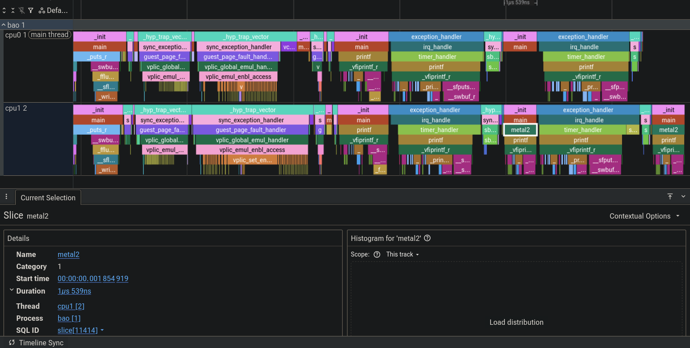
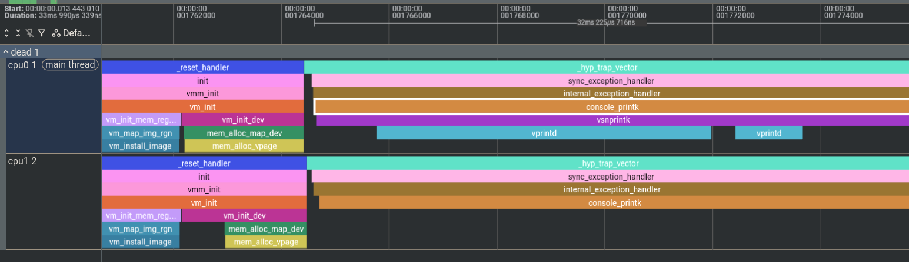
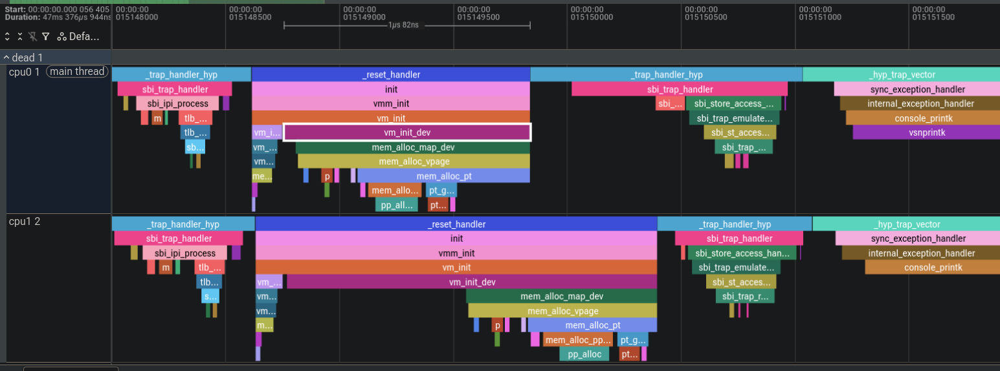

# 简介

本文介绍了一个自制工具如何帮助排查RISC-V 32位目标上遇到的多核Bao-hypervisor问题。

## 单客户机

学习用的Bao于26年6月从上游`main`分支的`6d21d15`处切出来。 之后数月一直使用单客户机配置熟悉它。在26年11月1日前，因精力有限，除构建问题外，并没有深入探索它。

## 间歇停顿

最近在Bao上尝试用两个客户机时调试一个自制跟踪重建工具时遇到间歇性停顿问题：在hypervisor的banner行之后，控制台没有任何输出。由于该问题并非每次都出现，而当时专注于跟踪工具，所以没去排查Bao侧的问题。

## 跟踪工具

我的自制跟踪重建工具的目标是在能跨越 固件、hypervisor、os和app 等多层软件系统跟踪CPU所执行的函数调用链。例如下面的Bao和两个裸机客户的重建截图[^1]：

# 调查

此前对跟踪工具只是用于性能调查——即回答某操作耗时多久。但后来回想间歇性停顿问题时，一个新念头闪现: 停顿发生时的重建结果长什么样？

## 发现死循环

为此我尝试重建了停顿时的执行流程，其末尾部分如下：

结合Bao源码阅读该图，不难发现CPU0处于临界区但停顿了，而CPU1在临界区外等待，因此两个客户机都停顿了，所以未能在控制台上显示各自的banner。

进一步检查发现，`lib/printk.c`中的`vsnprintk` 里存在一个死循环，由内部异常处理函数给出的`%04lx`格式符触发。后来注意到上游该问题已于10月9日被`ec86e76 fix(lib): printk conversion parsing`修复，于是取消了提交自己修复的尝试。

## 崩溃根因

排除死循环后，两个客户机的崩溃打印终于出现了——它们之前被被死循环阻塞。不过崩溃打印中缺少`scause`寄存器，因此我向上游提交了`8fa6a0d fix(riscv): dump scause on panic`，已被采纳。

为找到崩溃的原因，把OpenSBI固件也纳入跟踪重建范围，以完整了解异常之前的过程：

这里`_trap_handler_hyp`属于OpenSBI固件，而`_hyp_trap_vector`和`_reset_handler`属于Bao hypervisor。顺着panic dump和客户机准备逻辑，最终发现为Bao配的内存尺寸大于目标板的实际值，因此在客户机准备时发生了越界写导致了panic。

我推测两个客户机的非确定性分配请求及4M的对齐要求导致分配器的游标推到物理内存范围之外。我还需要更多时间消化分配逻辑细节，但把内存调整为合适大小后，再也未能复现该问题。

# 总结

跟踪重建通常用于性能调查，但它所呈现的错误线索使其同样适用于故障调查。

# 参考资料

[^1]: 这里有简化的重建样本: 一个是正常工作的[带两个裸金属客户的Bao](https://ui.perfetto.dev/?url=https://yf13.github.io/pages/pftrace/bao.pftrace)，一个是[带hello应用的Linux](https://ui.perfetto.dev/?url=https://yf13.github.io/pages/pftrace/vmlinux.pftrace)，浏览器打开用`WASD`进行平移/缩放操作。
