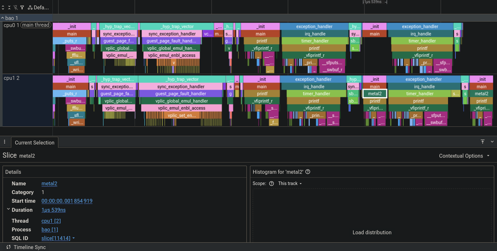
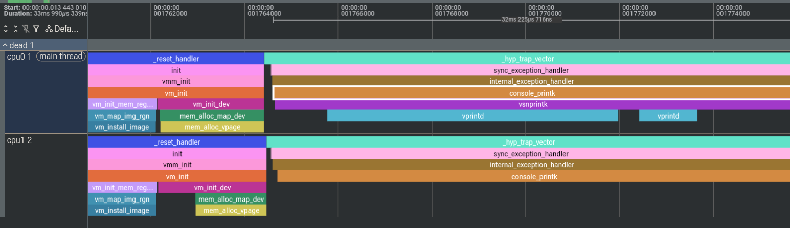
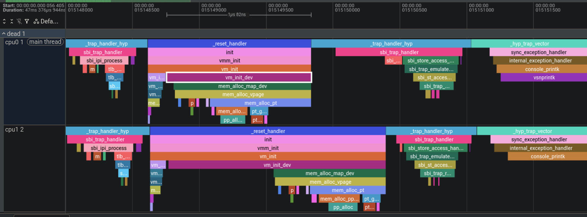

# Introduction

This document describes how a self-made tool helped with multi-core issue investigation in the Bao hypervisor on a RISC-V 32-bit target. we have [Chinese version](bao-fault.cn.md) as well.

## Single guest

Bao was forked in June at `6d21d15` from the upstream `main` branch. Then a simple one bare-metal guest config is used for months. Before November 2026, I had little bandwidth, so apart from some build issues I did not explore it much.

## Intermittent stall

Recently, while trying a self-made trace tool with two guests on Bao, I hit an intermittent stall issue where nothing was shown on the console after the hypervisor banner line. As the issue does not happen every time and I was working on the trace tool, I did not investigate the Bao side at that time.

## Trace tool

The main goal of my self-made trace tool is to reconstruct call chains in a system of firmware/hypervisor/os/app etc. Here is screen shot of reconstructed Bao with two bare metal guests[^1]:

# Investigation

Previously, the trace tool had only been used for performance investigation —- answering how long certain operations take. But after the intermittent stall appeared, a new question arose: what does the execution flow look like right before the stall?

## Dead loop found

To answer that, the execution flow leading up to the stall was reconstructed. The ending part of the reconstruction looks like this:

Reading it together with the Bao source, we saw that CPU0 was in the critical section but stalled, while CPU1 was waiting outside of it, so both guests stalled and failed to show their banners on the console.

A further check revealed that there is a dead loop inside `vsnprintk` in `lib/printk.c`, which was triggered by the `%04lx` format specifier given by the internal exception handler. Later I noticed that the issue had been fixed upstream by `ec86e76 fix(lib): printk conversion parsing` on October 9th, so I canceled upstreaming mine.

## Root cause

With the dead loop out of the way, the panic dumps for both guests finally appeared—they had been blocked by the loop all along. The dump, however, missed the `scause` register, so we upstreamed `8fa6a0d fix(riscv): dump scause on panic` to include it.

Actually, the same trace can be reconstructed together with the OpenSBI firmware to see what happened before the internal exception:

Here the `_trap_handler_hyp` chain is from the OpenSBI firmware, and the `_hyp_trap_vector` and `_reset_handler` chains are from the Bao hypervisor.

Following the panic dump and the guest preparation logic, we finally found that the memory size I configured for Bao was larger than actual size of my target; thus, out-of-range writes happened when preparing the guests, which finally led to the panic.

I guess the non-determinism of allocation requests for two guests pushed the cursor out of the proper range backed by physical memory when fulfilling alignment requirements. I still need more time to fully digest the details, but after configuring proper memory size, I never reproduced the issue.

# Summary

Trace reconstruction often serves performance investigation, but the error clues it surfaces make it equally useful for fault investigation.

# References

[^1]: Here are simplified samples for [Bao with two guests](https://ui.perfetto.dev/?url=https://yf13.github.io/pages/pftrace/bao.pftrace) and for [Linux with hello world app](https://ui.perfetto.dev/?url=https://yf13.github.io/pages/pftrace/vmlinux.pftrace). Once loaded in browser, use `WASD` keys for pan/zoom operations.